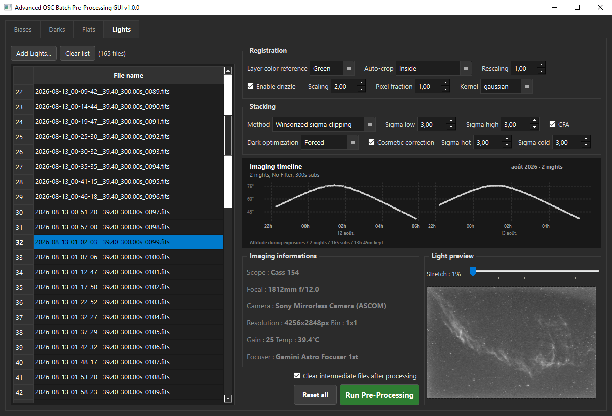
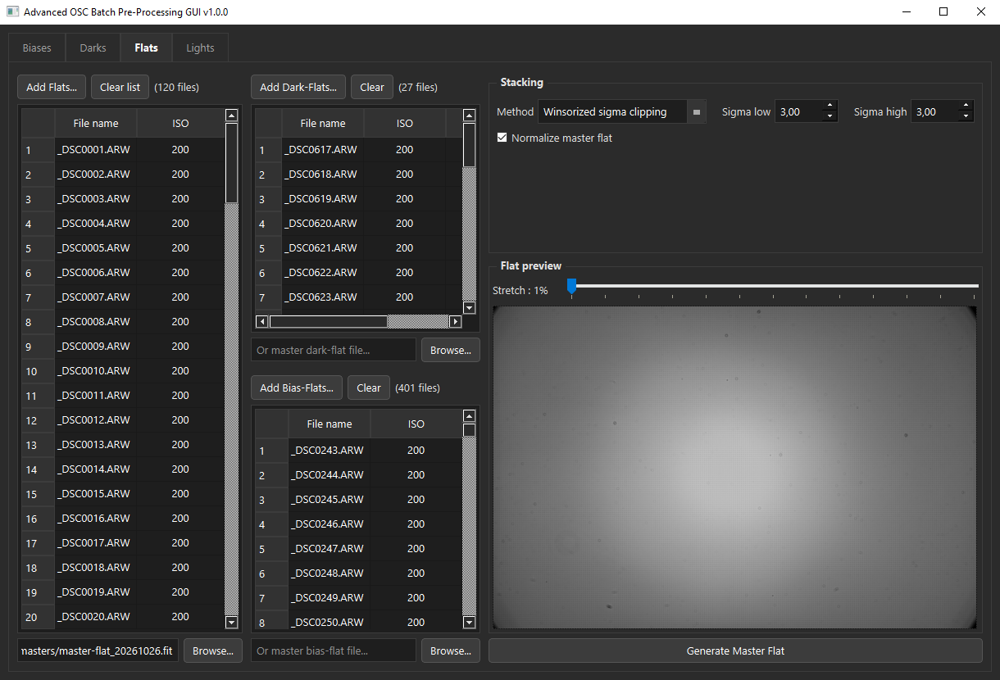
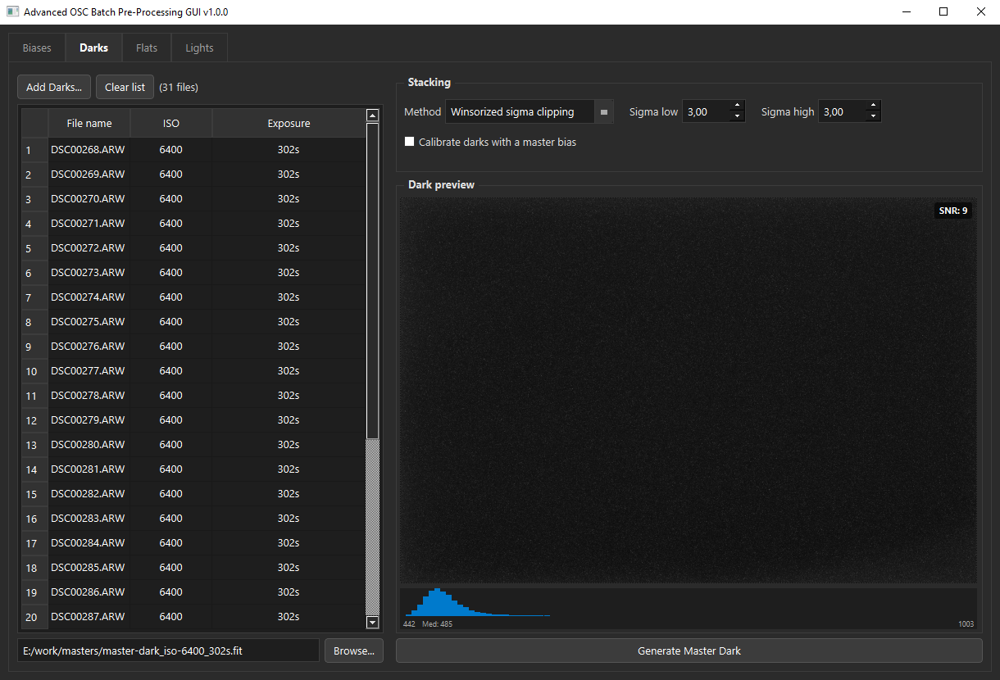
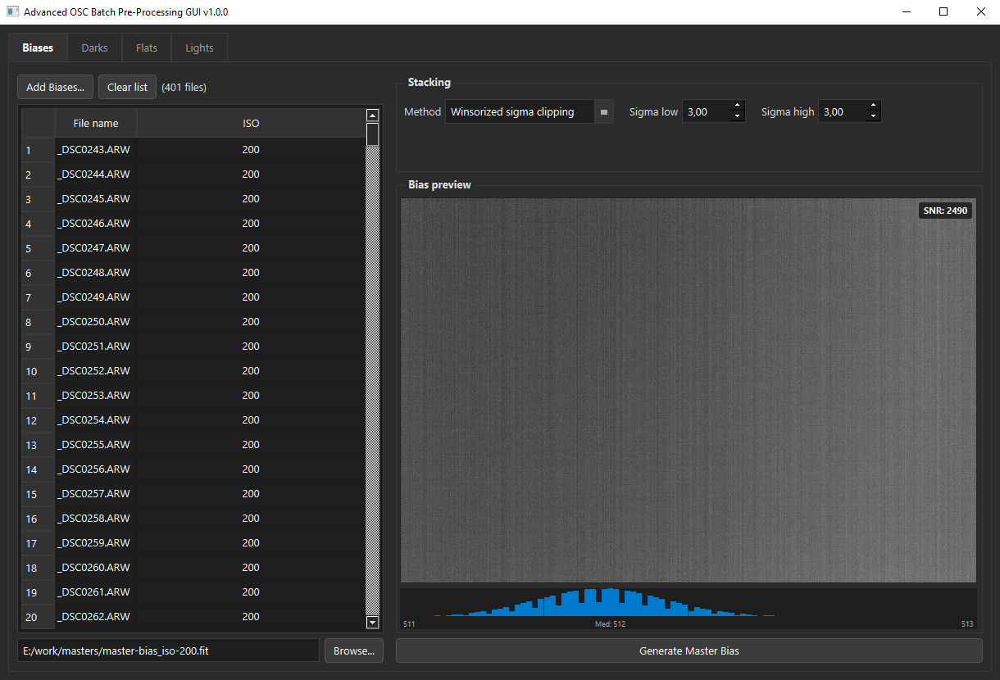

<h3>Advanced OSC Batch Pre-Processing GUI for Siril</h3>
Version 1.0.0 — © SpcCb 2026 

AOBPP GUI is an graphical user interface Python script for <a href="https://siril.org/">Siril</a> astronomical software, designed for pre-processing OSC frames with advanced interactive features.

<h2>Installation</h2>

• Download <a href="https://github.com/SpcCb/AOBPP-GUI/blob/main/aobpp_gui.py">aobpp_gui.py</a>. 
• Place the file in the "scripts" folder under Siril installation folder. 
• In Siril, open Preferences → Scripts and add that folder to the script search paths if necessary. 
• Apply the changes or restart Siril. 
• Open "aobpp_gui.py" in the menu: Scripts → Python Scripts → Scripts. 

AOBPP GUI is designed for Siril 1.4.5 or newer. On first launch, Siril may need to install the required Python packages in its own environment.

<h2>Screenshots</h2>

 
 
 

